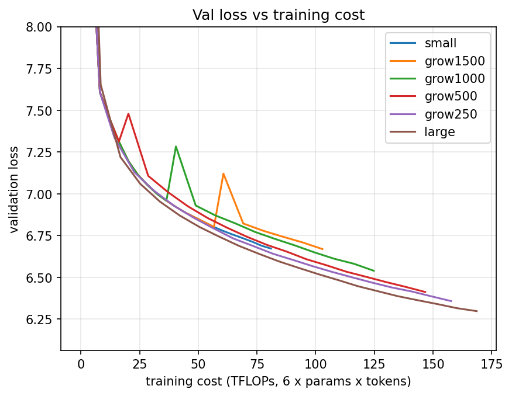

# Results: first growth-timing sweep

**Short answer:** at these sizes, growing never saved compute. Training the large model from the
start reached a lower validation loss than every grown run at every equal cost. Growing earlier
was always better than growing later.

## Setup

- Code: `src/train.py` and `src/growth.py` on this branch, unchanged (`python src/train.py small | large | grow N`).
- Small: 64 wide, 2 heads, 2 layers (about 6.6M parameters). Large: 128 wide, 4 heads, 4 layers (about 13.7M).
  Most parameters are the 50,257-token embedding and output layers.
- WikiText-2, GPT-2 tokens, batch 16 x 64 tokens, 2000 steps, AdamW lr 3e-4, fresh optimizer after growing.
- Growth: copy each small weight into the top-left corner of the large one (not function-preserving).
- Cost = 6 x parameters x tokens. Val loss = mean of the same 20 validation batches in every run.
- One seed per run, CPU only (1 thread), about 30 minutes per run.
- Raw numbers: `results_<run>.csv` (step, tflops, val_loss every 100 steps), as written by `train.py`.

## Validation loss at the same cost

Each row is one run's total cost; blank = that run never spent that much.

| TFLOPs | small | grow 1500 | grow 1000 | grow 500 | grow 250 | large |
|---:|---:|---:|---:|---:|---:|---:|
| 80.9  | 6.672 | 6.765 | 6.738 | 6.686 | 6.646 | **6.614** |
| 102.8 |       | 6.669 | 6.634 | 6.580 | 6.550 | **6.512** |
| 124.8 |       |       | 6.539 | 6.491 | 6.466 | **6.423** |
| 146.7 |       |       |       | 6.412 | 6.396 | **6.354** |
| 157.6 |       |       |       |       | 6.358 | **6.323** |
| 168.6 |       |       |       |       |       | 6.298 |

## What this tells us

1. **The large model was more efficient than the small one after about 10 TFLOPs**, so there was
   no cheap small-model phase for growth to exploit. That is why no switch point won.
2. **Growing causes a loss jump**: right after growing, val loss is higher than the small model's at
   the same step by +0.28 (step 500), +0.36 (step 1000) and +0.34 (step 1500). It recovers within
   about 100 steps but never catches the large run. (Before growing, each grow run matches the
   small run exactly.)
3. **Earlier is better:** grow 250 ended 0.035 behind large at equal cost; grow 1500 was worst.

## Limits and next steps

- One seed each, short runs, small models: differences under about 0.05 may be noise.
- The corner copy breaks the trained model (the jump). A function-preserving growth method is the
  obvious next test.
- A bigger size gap, or a learning-rate schedule with warm-up after growing, could change the answer.
